# Findings

Results from [`inflation_analysis.ipynb`](inflation_analysis.ipynb). "Average annual inflation" means the compound yearly rise in a country's consumer price index over its longest consistent period of data, usually 2000–2021 (see the [method](README.md#method)). Group comparisons use medians, so a few hyperinflation cases don't dominate.

**Contents**

1. [How fast prices rose](#1-how-fast-prices-rose)
2. [Food vs. general prices](#2-food-vs-general-prices)
3. [Richer vs. poorer countries](#3-richer-vs-poorer-countries)
4. [Continents](#4-continents)
5. [Inflation over time](#5-inflation-over-time)
6. [COVID-19](#6-covid-19)
7. [Inflation and the wider economy](#7-inflation-and-the-wider-economy)
8. [Countries grouped by their price path](#8-countries-grouped-by-their-price-path)
9. [Forecasting](#9-forecasting)
10. [Pakistan and Southern Asia](#10-pakistan-and-southern-asia)
11. [Limitations](#limitations)

---

## 1. How fast prices rose

**In the typical country, prices rose about 3% a year.** Across the 194 countries with general CPI data, the median average annual inflation was 3.1%. For food prices (156 countries) it was 3.6%.

The extremes were far apart:

| Highest | % a year | Period | | Lowest | % a year | Period |
| --- | ---: | --- | --- | --- | ---: | --- |
| Venezuela | 694.9 | 2010–2021 | | Kiribati | 0.06 | 2010–2019 |
| South Sudan | 63.7 | 2010–2021 | | Japan | 0.11 | 2000–2021 |
| Zimbabwe | 43.7 | 2010–2021 | | Libya | 0.12 | 2000–2010 |
| Sudan | 34.8 | 2000–2021 | | Brunei Darussalam | 0.37 | 2000–2021 |
| Angola | 29.2 | 2000–2019 | | Switzerland | 0.38 | 2000–2021 |

At 695% a year, Venezuelan prices rose roughly eightfold every year on average. Japan's prices, by contrast, were only about 2% higher in 2021 than in 2000.

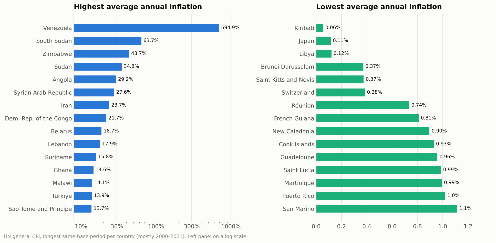

On the map, the highest inflation is concentrated in sub-Saharan Africa, the Middle East and Venezuela. Rates below 2% a year are found mainly in Western Europe, Japan, Canada, Saudi Arabia and some other Gulf states, and several small island economies.

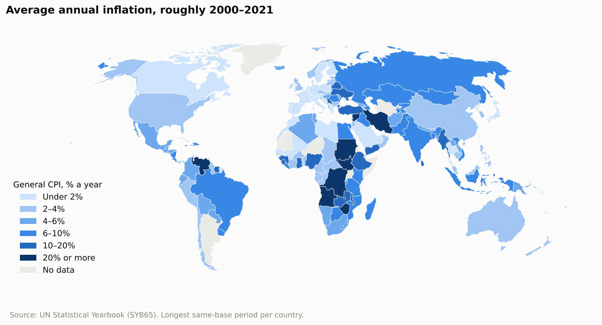

## 2. Food vs. general prices

**Food prices rose faster than prices in general in 123 of 156 countries (79%).** The median gap was 0.64 percentage points a year in food's favour. Both series are measured over exactly the same years for each country. This matters because food data often starts in 2010 while general data starts in 2000, so comparing each over its own date range would mix periods with very different inflation.

Most countries sit close to the diagonal, so food and general inflation usually move together. The largest exceptions run both ways: food rose much faster than other prices in Maldives, Laos and Guatemala, while in Papua New Guinea food prices rose far more slowly than everything else.

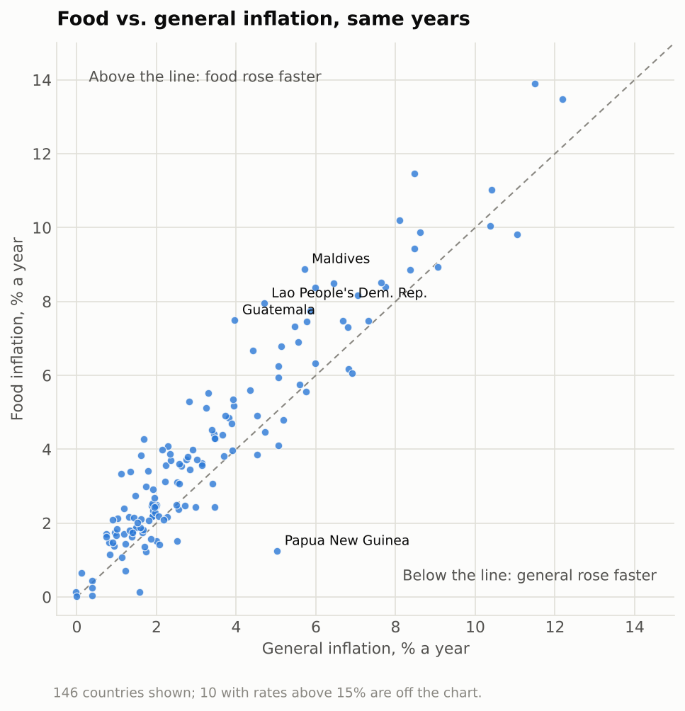

## 3. Richer vs. poorer countries

**Inflation falls steadily as countries get richer.** By World Bank income group:

| Income group | Countries | Median % a year |
| --- | ---: | ---: |
| Low income | 20 | 8.6 |
| Lower-middle income | 45 | 6.0 |
| Upper-middle income | 53 | 4.3 |
| High income | 68 | 1.9 |

High-income countries had a median of 1.9% a year, against 5.5% for all other countries combined. The same pattern holds for GDP per head: across 186 countries, the rank correlation between income and inflation is −0.60.

Means tell a distorted story here. Venezuela alone pushes the lower-middle-income mean to 23.0%, almost four times that group's median.

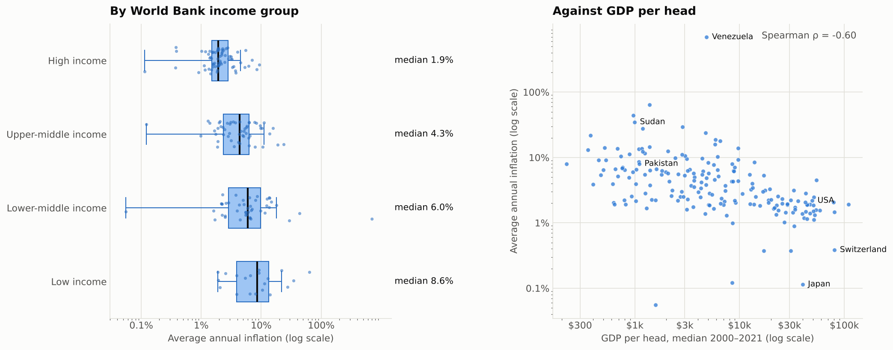

## 4. Continents

| Continent | Countries | Median % a year | Mean % a year |
| --- | ---: | ---: | ---: |
| Africa | 50 | 5.5 | 9.1 |
| South America | 12 | 4.7 | 63.0 |
| Asia | 44 | 4.5 | 6.1 |
| Oceania | 15 | 2.8 | 3.0 |
| North America | 30 | 2.1 | 3.3 |
| Europe | 43 | 1.9 | 3.2 |

**Africa had the highest typical inflation and Europe the lowest.** South America's mean of 63% is almost entirely Venezuela. Its median of 4.7% is the better guide. The spread within each continent is wide, and Asia and Africa in particular include both very low and very high inflation countries.

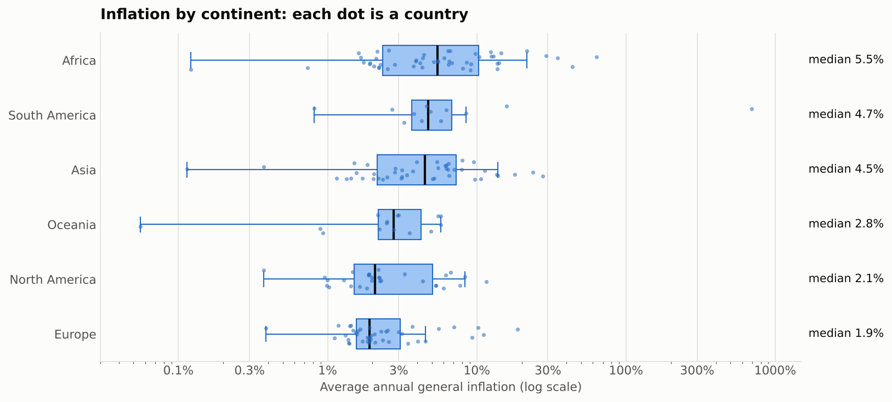

## 5. Inflation over time

The World Bank's yearly figures show inflation in the typical country (171 countries with at least 20 years of data):

| | 2007 | 2008 | 2009 | 2019 | 2020 | 2021 | 2022 | 2023 |
| --- | ---: | ---: | ---: | ---: | ---: | ---: | ---: | ---: |
| Median country, % | 4.8 | 8.9 | 2.8 | 2.1 | 1.8 | 3.4 | 7.9 | 5.6 |
| Countries above 10% | 13% | 42% | 12% | 6% | 6% | 6% | 31% | 21% |

- **2008 was the sharpest spike.** The food and fuel price surge pushed the median country to 8.9%, with 42% of countries in double digits. It reversed within a year.
- **The 2010s were unusually calm.** Median inflation fell to 1.5% in 2015 and 2016, the lowest in the period.
- **2022 was nearly as broad as 2008 and lasted longer.** The median reached 7.9% and 31% of countries were above 10%. In 2023 the median was still 5.6%, twice the 2009 level after the previous spike.

The highest rates in 2022 were in Lebanon (171%), Sudan (139%), Zimbabwe (105%), Argentina (72%) and Türkiye (72%). In 2023 they were in Lebanon (221%), Argentina (134%) and Türkiye (54%).

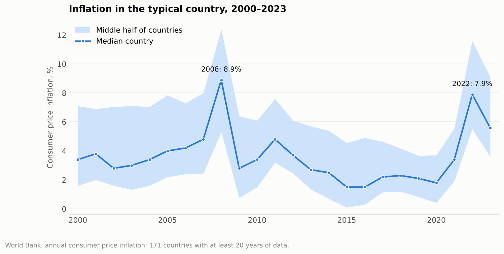

## 6. COVID-19

Each country's inflation in 2020 and 2021 is compared with its own average pace in 2015–2019, using the UN's separate food and general indices.

| Median across countries | 2015–19, per year | 2020 | 2021 |
| --- | ---: | ---: | ---: |
| General prices | 1.9% | 1.8% | 3.5% |
| Food prices | 2.2% | 3.3% | 3.1% |

**Food prices moved first.** In 2020, food inflation jumped by about a percentage point while general inflation barely changed. **General prices followed in 2021**, nearly doubling from their pre-pandemic pace. General inflation in 2021 was above the country's own 2015–2019 pace in 77% of countries (153). Food inflation was above it in 56% (103).

The largest jumps in 2021 came in countries already in crisis. In Sudan, inflation went from 40% a year before the pandemic to 434% in 2021, and in Lebanon from 3% to 155%.

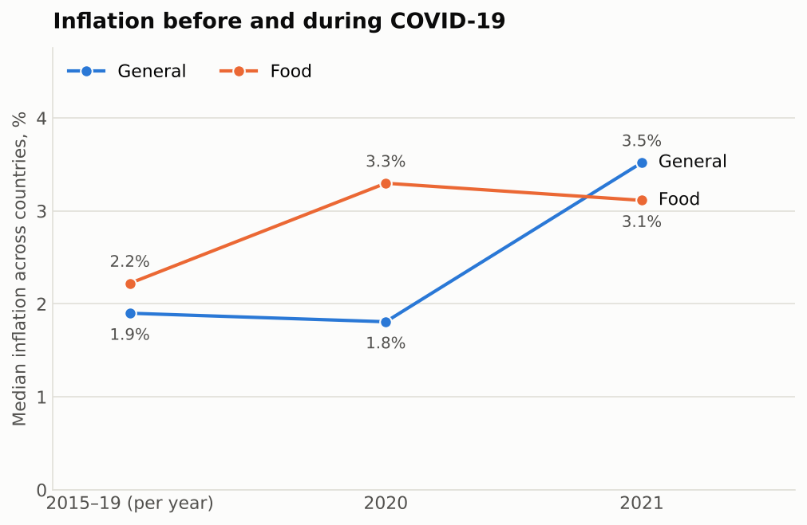

## 7. Inflation and the wider economy

World Bank data for 2000–2023, using rank correlations both across countries and within each country over time:

| | Across countries | Within countries (median) | Countries where the link is negative |
| --- | ---: | ---: | ---: |
| Unemployment | +0.05 (not significant) | −0.12 | 64% of 172 |
| GDP growth | +0.29 | +0.07 | 40% of 182 |

- **Unemployment.** Across countries there is no link: countries with high typical unemployment don't have systematically different inflation. Within countries there is a weak tendency in line with the Phillips curve: in 64% of countries, years of lower unemployment came with somewhat higher inflation. The relationship is weak (median ρ of −0.12).
- **Growth.** Faster-growing countries had somewhat *higher* inflation, which mostly reflects that developing economies tend both to grow faster and to have higher inflation. Within countries there is no consistent link, so in this data high-inflation years were not generally low-growth years.

These are correlations, not causes. Many unemployment figures for lower-income countries are ILO modelled estimates rather than survey measurements.

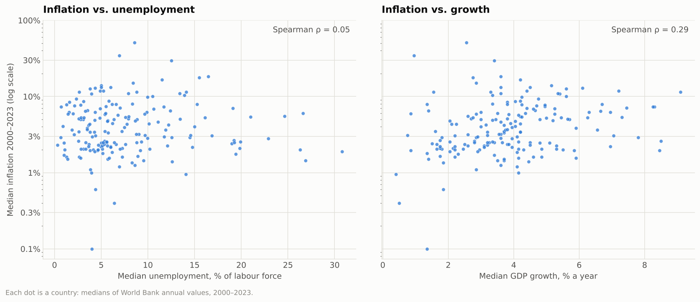

## 8. Countries grouped by their price path

128 countries have general CPI on a single base for all of 2005, 2010, 2015, 2019, 2020 and 2021. Clustering their price paths gives the cleanest separation with **two groups** (silhouette score 0.77, against 0.65 or less for three to six groups):

| Group | Countries | Median % a year, 2005–2021 | Members |
| --- | ---: | ---: | --- |
| Group 1: steady | 119 | 2.6 | The large majority, for example Cameroon, Australia, Montenegro and Albania |
| Group 2: high inflation | 9 | 12.3 | Sudan, Belarus, Suriname, Guinea, Ghana, Ukraine, Nigeria, Egypt, Türkiye |

There is no gradual spectrum of "medium-inflation" clusters. Most countries follow similar, gently rising paths, and a small set breaks away with persistent high inflation. Several of the nine also had major currency devaluations in this period.

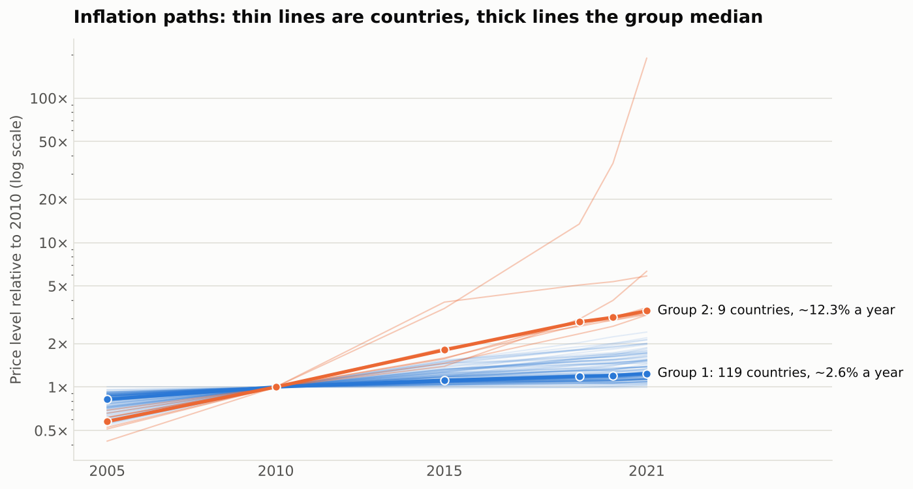

## 9. Forecasting

### Trend lines on the price index

Trend lines fitted to each country's CPI for 2000–2015 were used to predict 2021, then compared with the actual 2021 value (180 series).

| Median error in the 2021 prediction | General | Food |
| --- | ---: | ---: |
| Linear trend (same amount each year) | 6.6% | 4.8% |
| Compound trend (same percentage each year) | 11.3% | 9.3% |

**The simpler linear trend did better**, even though inflation compounds in principle. The compound trend was closer in only 23% of cases and over-predicted 2021 prices in 89%. The reason is that **inflation slowed**. The median country's inflation fell from 3.6% a year in 2000–2010 to 2.2% in 2010–2019, and it slowed in 85% of 138 countries. A compound trend fitted on the faster 2000s projects that pace forward and overshoots.

Extending the linear trend to 2030 projects higher prices than today's in 193 of 197 countries (general) and 134 of 137 (food). Given the errors above, these are directions rather than precise forecasts.

### Year-ahead inflation forecasts

Three simple methods were used to forecast each country's yearly inflation four years ahead, in a calm period and in a shock:

| Median error, percentage points | Calm: 2016–2019 | Shock: 2020–2023 |
| --- | ---: | ---: |
| Last value | 1.55 | 3.15 |
| 5-year average | 1.46 | 3.13 |
| AR(1) model | 1.70 | 2.72 |

- **In calm years, the plainest method won.** Averaging the last five years beat both the last value and the AR(1) model.
- **The shock doubled every method's error.** No method trained only on past inflation anticipated 2021–2022.
- **AR(1) held up best in the shock**, because it pulls forecasts back toward each country's long-run average, which was higher than the low inflation of the late 2010s.

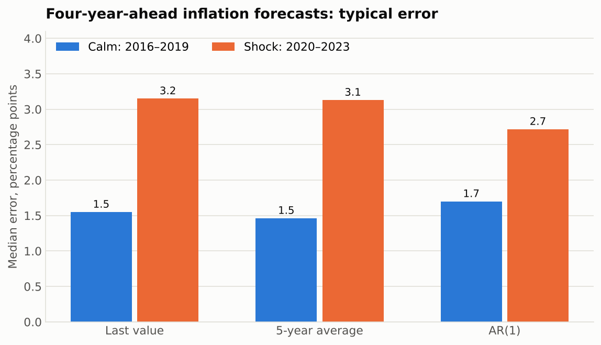

## 10. Pakistan and Southern Asia

**Pakistan's average annual inflation was 8.0% from 2000 to 2021**, compared with a world median of 3.1%. World Bank yearly figures compare it with the rest of Southern Asia (Afghanistan, Bangladesh, Bhutan, India, Iran, Maldives, Nepal and Sri Lanka):

| | Pakistan | Neighbours (median) |
| --- | ---: | ---: |
| Median year, 2000–2023 | 7.8% | 5.8% |
| Average, 2015–2019 | 5.2% | 4.2% |
| Average, 2019–2023 | 16.1% | 5.7% |
| 2022 | 19.9% | 7.7% |
| 2023 | 30.8% | 6.4% |

- **Pakistan's inflation was above the neighbours' median in 16 of the 24 years.**
- **2008 was the first big spike**, at 20.3%, and inflation stayed above 12% through 2010. From 2011 to 2018 Pakistan tracked its neighbours closely, reaching a low of 2.5% in 2015.
- **From 2019 it broke away.** Inflation stayed near 10% through 2019–2021, then rose to 19.9% in 2022 and 30.8% in 2023. In 2023 only Iran (44.6%) was higher in the region. Sri Lanka, which peaked at 49.7% in 2022, fell back to 16.5% in 2023.
- **Prices in Pakistan in 2023 were roughly eight times their 2000 level.**

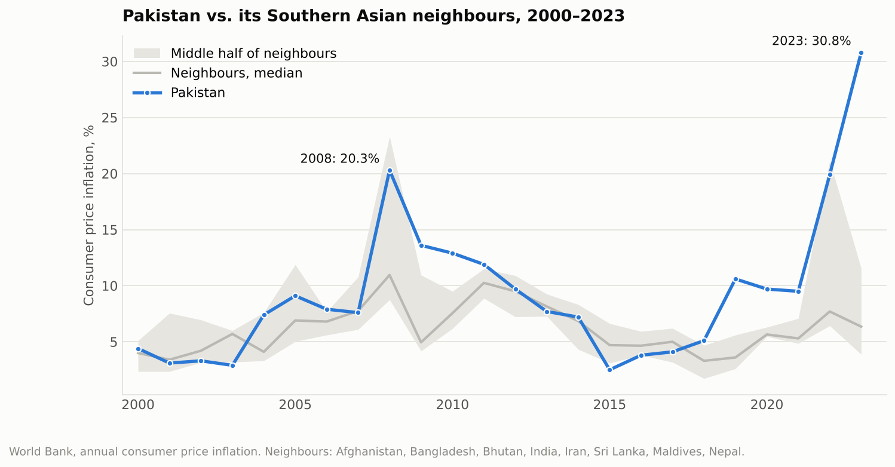

## Limitations

- **Sparse UN years.** The UN table has values only for 2000, 2005, 2010, 2015, 2019, 2020 and 2021, so annual rates are averages over multi-year gaps. The World Bank series fill in individual years.
- **Different periods.** Where a country's index changes base, or data is missing, its average rate covers a shorter period than 2000–2021. The notebook records the period used for each country (the `start` and `end` columns).
- **Gaps in coverage.** The World Bank inflation series for Venezuela covers only 2009–2016, and Argentina's starts in 2018. Several conflict-affected countries, such as Yemen and South Sudan, are missing years, and a few, such as Somalia and Eritrea, have no World Bank inflation data.
- **Small islands** are in the analysis but are too small to show on the map.
- **Income groups** are the World Bank's current classification, applied to the whole period.
- **Correlation, not causation.** Section 7 describes associations only.
