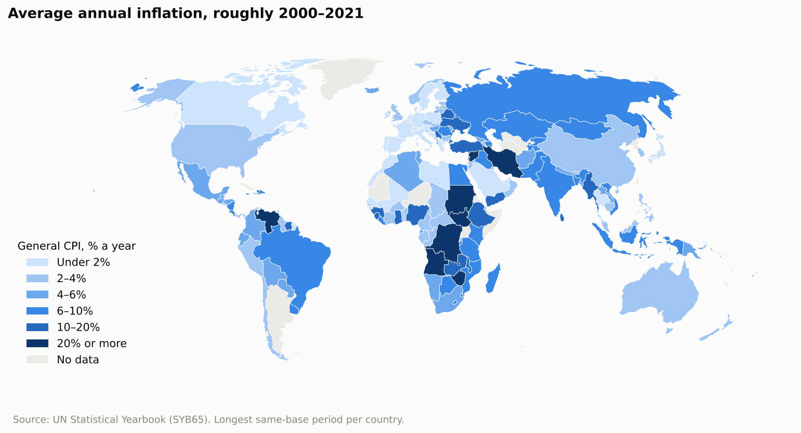

<h1 align="center">CPI Inflation Analysis</h1>

<p align="center">
  <b>How fast prices rose in about 200 countries from 2000 to 2023, and what goes along with high inflation</b>
</p>

<p align="center">
  
  
  
  
  
  
</p>

<p align="center">
  <a href="inflation_analysis.ipynb"><b>Notebook</b></a> ·
  <a href="FINDINGS.md"><b>Findings</b></a> ·
  <a href="data">Data</a>
</p>

<p align="center">
  
</p>

## Overview

The Consumer Price Index (CPI) tracks what consumers pay for a fixed basket of goods and services, which makes it the standard measure of inflation. This project combines the United Nations' CPI tables with World Bank indicators to answer a set of questions about inflation around the world:

- How fast did prices rise in each country, and where were the extremes?
- Did food prices rise faster than prices in general?
- How does inflation differ between richer and poorer countries, and between continents?
- How did inflation move over time, through the 2008 spike, COVID-19 and the 2022 surge?
- Does inflation go along with unemployment or economic growth?
- Do countries fall into distinct groups by how their prices moved?
- How well do simple forecasts work, in calm years and in a shock?
- How does Pakistan compare with its Southern Asian neighbours?

Everything is in one notebook, [`inflation_analysis.ipynb`](inflation_analysis.ipynb). The results are written up, with charts, in **[`FINDINGS.md`](FINDINGS.md)**.

## Key findings

- **The typical country's prices rose about 3% a year** (median 3.1%), from 0.1% a year in Japan to roughly 695% in Venezuela.
- **Food prices rose faster than prices in general in 79% of countries**, when both are measured over the same years.
- **Poorer countries had much higher inflation.** The median low-income country averaged 8.6% a year and the median high-income country 1.9%. Africa had the highest median of any continent (5.5%) and Europe the lowest (1.9%).
- **2022 was the broadest inflation surge since 2008.** The median country hit 7.9% (8.9% in 2008), and almost a third of countries were above 10%.
- **During COVID-19, food prices moved first.** Food inflation jumped in 2020 while general inflation barely changed; general inflation caught up in 2021.
- **Pakistan's inflation was persistently above its neighbours'.** It reached 30.8% in 2023, against a median of 6.4% for the rest of Southern Asia.

See [`FINDINGS.md`](FINDINGS.md) for the full results, including the links with unemployment and growth, the country groupings and the forecasting tests.

## Data

All data is in [`data/`](data), so the notebook runs without downloading anything.

| Source | What | Coverage |
| --- | --- | --- |
| [UN Statistical Yearbook](https://data.un.org/), 65th issue (September 2022) | Consumer price index, general and food | 202 countries and areas; 2000, 2005, 2010, 2015, 2019, 2020, 2021 |
| [World Bank, World Development Indicators](https://data.worldbank.org/) (API, last updated 11 November 2026) | Annual inflation, unemployment, GDP growth, GDP per head, income groups | 2000–2023 |
| [Datahub country codes](https://github.com/datasets/country-codes) | ISO and UN M49 codes, continents and UN regions | 249 countries and territories |
| [Natural Earth](https://www.naturalearthdata.com/) | Low-resolution country boundaries for the map | World |

The UN and World Bank files are kept as downloaded, apart from reshaping. Details, indicator codes and licences are in [`data/README.md`](data/README.md).

## Method

**Cleaning the UN data.** The UN table's footnotes change how its numbers should be read, so the notebook handles three things before calculating anything:

- **Unit changes.** Six of Venezuela's values are given "in millions" or "in billions" and are scaled back to plain index values.
- **Placeholder zeros.** Two zero values (Ethiopia and Maldives, 2005) are treated as missing.
- **Index-base changes.** 35 of the 386 series switch index base partway through, for example from 2010 = 100 to 2018 = 100. Each series is split into same-base segments, and price changes are only measured within a segment.

**Average annual inflation.** Each country's rate is the compound annual growth of its price index over its longest same-base period (at least five years, usually 2000–2021):

$$r = \left(\frac{CPI_{\text{end}}}{CPI_{\text{start}}}\right)^{1/(\text{end} - \text{start})} - 1$$

Unlike a total percentage change, this is comparable between countries whose data covers different years. Food and general inflation are always compared over the same years.

**Other methods.**

- Medians, rather than means, summarise groups, so a few hyperinflation cases don't dominate.
- Relationships are measured with Spearman rank correlation, both across countries and within each country over time.
- Countries are grouped by k-means clustering of their log price paths, with the number of groups chosen by silhouette score.
- Forecasts are tested out of sample: trend lines fitted to 2000–2015 and checked against 2021, and year-ahead models (last value, 5-year average, AR(1)) checked on 2016–2019 and 2020–2023.

## Running it

```bash
pip install -r requirements.txt
jupyter notebook inflation_analysis.ipynb
```

Running the notebook from top to bottom regenerates every table and every chart in [`charts/`](charts). It takes under a minute.

## Authors

**Asad Shahab** · Mahad Iqbal

The project began as coursework for CS439 Data Science at the GIK Institute of Engineering Sciences and Technology.
